# Entity Relationship Diagram (ERD) & Skema Basis Data MySQL
## Sistem Internal Keuangan & Operasional PT. Inovasi Digital Kreasi

- **Dokumen Versi:** 2.0.0
- **Dialek Basis Data:** MySQL 8.0+ (InnoDB Engine, `utf8mb4`)
- **Kesesuaian:** 100% Selaras dengan `PRD.md`, `Api.md`, Antarmuka UI/UX, dan Tipe Data TypeScript (`src/types/index.ts`)
- **Lokasi Berkas:** Root Project (`/ERD.md`)

---

## 1. Diagram Relasi Entitas (Mermaid ERD)

```mermaid
erDiagram
    USERS ||--o{ FUND_REQUESTS : "creates / approves"
    USERS ||--o{ GROUP_DISBURSEMENTS : "creates"
    USERS ||--o{ DISBURSEMENT_EXECUTIONS : "executes"
    USERS ||--o{ INCOME_RECORDS : "records"
    USERS ||--o{ SYSTEM_LOGS : "generates"
    USERS ||--o{ API_CREDENTIALS : "manages"

    PROJECTS ||--o{ FUND_REQUESTS : "allocated_to"
    PROJECTS ||--o{ INCOME_RECORDS : "receives_into"
    PROJECTS ||--o{ TRANSACTIONS : "tagged_with"

    INCOME_CATEGORIES ||--o{ INCOME_RECORDS : "categorizes"

    EMPLOYEES ||--o{ PAYROLL_ITEMS : "listed_in"
    EMPLOYEES ||--o{ GROUP_DISBURSEMENT_DETAILS : "selected_in"

    FUND_REQUESTS ||--o{ FUND_REQUEST_REVISIONS : "tracks"
    FUND_REQUESTS ||--o{ PAYROLL_ITEMS : "breaks_down"
    FUND_REQUESTS ||--o{ INVOICE_ITEMS : "itemizes"
    FUND_REQUESTS ||--o| TRANSACTIONS : "disburses_to"

    GROUP_DISBURSEMENTS ||--o{ GROUP_DISBURSEMENT_DETAILS : "comprises"
    GROUP_DISBURSEMENTS ||--o{ DISBURSEMENT_EXECUTIONS : "executed_in"

    INCOME_RECORDS ||--o| TRANSACTIONS : "booked_as"

    USERS {
        varchar(64) id PK "usr-1"
        varchar(128) name "Nama Lengkap"
        varchar(128) email UK "email@inovasidigital.id"
        varchar(255) password_hash "Hashed Password"
        enum role "admin | finance_manager"
        varchar(32) phone "0812xxxx"
        datetime created_at
        datetime updated_at
    }

    EMPLOYEES {
        varchar(64) id PK "emp-1"
        varchar(128) nama "Nama Karyawan"
        varchar(64) bank "BCA, Mandiri, BNI, BRI, BSI"
        varchar(64) no_rek "Nomor Rekening"
        varchar(128) atas_nama "Nama Pemilik Rekening"
        varchar(255) lampiran_ktp_url "URL berkas KTP"
        datetime created_at
        datetime updated_at
    }

    PROJECTS {
        varchar(64) id PK "prj-1"
        varchar(128) nama UK "KawanEdu | Terniva | Scrava"
        varchar(16) kode UK "KWE | TRN | SCR"
        varchar(64) bank_name "BCA | Mandiri | BNI"
        varchar(128) no_rek_bank "Rekening Penampungan"
        varchar(128) atas_nama "PT Inovasi Digital Kreasi"
        text deskripsi "Deskripsi Proyek"
        datetime created_at
    }

    INCOME_CATEGORIES {
        varchar(64) id PK "cat-1"
        varchar(128) keterangan "Pembayaran SPP, Pendaftaran, dll"
        datetime created_at
    }

    FUND_REQUESTS {
        varchar(64) id PK "req-1"
        varchar(64) nomor_pengajuan UK "ND-OPR-202610-001"
        enum kategori "operasional|payroll|reimburse|pajak|pengadaan|invoice"
        enum sumber "finance | pic"
        varchar(128) pic_name "Nama PIC Lapangan jika sumber pic"
        varchar(64) project_id FK "Referensi Proyek"
        varchar(128) nama_proyek "Nama Proyek Terkait"
        varchar(128) nama_pemohon "Nama Pemohon Dana"
        decimal(15_2) jumlah "Nominal Pengajuan (Rp)"
        varchar(64) bank_tujuan "Nama Bank Tujuan"
        varchar(64) no_rek_tujuan "Nomor Rekening Tujuan"
        varchar(128) atas_nama_tujuan "Nama Pemilik Rekening Tujuan"
        text keterangan "Keterangan Keperluan Dana"
        varchar(255) lampiran_nama "Nama File Lampiran"
        varchar(512) lampiran_url "URL Dokumen Pendukung"
        varchar(64) periode_payroll "Periode Penggajian / Masa Pajak"
        date tanggal_invoice "Tanggal Dokumen Tagihan"
        varchar(64) nomor_invoice "Nomor Seri Invoice"
        varchar(255) judul_invoice "Judul / Subjek Invoice"
        decimal(15_2) nominal_invoice "Total Nilai Tagihan Invoice"
        varchar(255) tujuan_invoice "Pihak yang Ditagih"
        enum status "draft|pending_pic_review|pending_admin_approval|approved|rejected|done"
        text catatan_penolakan "Catatan Evaluasi / Alasan Penolakan"
        text alasan_revisi "Catatan Revisi dari Finance"
        varchar(255) bukti_transfer_nama "Nama File Bukti Transfer"
        varchar(512) bukti_transfer_url "URL Berkas Bukti Transfer"
        date tanggal_transfer "Tanggal Eksekusi Transfer"
        varchar(128) disbursed_by "Finance yang Mengeksekusi Transfer"
        varchar(64) approved_by FK "Admin yang Menyetujui"
        datetime approved_at "Waktu Persetujuan"
        varchar(64) created_by FK "User Pembuat Pengajuan"
        datetime created_at
        datetime updated_at
    }

    FUND_REQUEST_REVISIONS {
        varchar(64) id PK "rev-1"
        varchar(64) fund_request_id FK "ID Pengajuan"
        text catatan "Rincian Perubahan Dokumen"
        varchar(128) diajukan_oleh "Finance Manager"
        datetime tanggal "Waktu Pengajuan Revisi"
    }

    PAYROLL_ITEMS {
        varchar(64) id PK "pay-1"
        varchar(64) fund_request_id FK "ID Pengajuan Payroll"
        varchar(64) employee_id FK "Referensi Karyawan (opsional)"
        int no_urut "Nomor Urut 1, 2, dst"
        varchar(128) nama "Nama Karyawan"
        varchar(64) bank "Bank Karyawan"
        varchar(64) no_rekening "Nomor Rekening Karyawan"
        decimal(15_2) jumlah "Nominal Gaji / Honor (Rp)"
    }

    INVOICE_ITEMS {
        varchar(64) id PK "invd-1"
        varchar(64) fund_request_id FK "ID Pengajuan Invoice"
        varchar(255) deskripsi "Rincian Tagihan Layanan / Produk"
        int qty "Kuantitas"
        decimal(15_2) harga_satuan "Harga Satuan (Rp)"
        decimal(15_2) total "Total Harga = Qty * Harga Satuan"
    }

    GROUP_DISBURSEMENTS {
        varchar(64) id PK "grp-1"
        varchar(128) judul "Judul Grup (misal: Karyawan KawanEdu)"
        text keterangan "Keterangan Grup"
        decimal(15_2) total_nominal "Total Nominal Akumulasi"
        varchar(64) created_by FK "Finance Manager"
        datetime created_at
        datetime updated_at
    }

    GROUP_DISBURSEMENT_DETAILS {
        varchar(64) id PK "gd-1"
        varchar(64) group_disbursement_id FK "ID Group"
        varchar(64) employee_id FK "ID Master Karyawan"
        varchar(128) nama "Nama Karyawan"
        varchar(64) bank "Bank Karyawan"
        varchar(64) no_rek "Nomor Rekening"
        decimal(15_2) nominal "Nominal Transfer (Rp)"
    }

    DISBURSEMENT_EXECUTIONS {
        varchar(64) id PK "exec-1"
        date tanggal "Tanggal Eksekusi Transfer"
        varchar(255) judul "Judul Eksekusi"
        varchar(64) group_disbursement_id FK "ID Group Terkait"
        varchar(128) group_judul "Nama Group"
        decimal(15_2) total_nominal "Total Nominal"
        int item_count "Jumlah Penerima"
        varchar(64) created_by FK "Finance Manager"
        datetime created_at
    }

    INCOME_RECORDS {
        varchar(64) id PK "inc-1"
        varchar(64) project_id FK "ID Proyek Terkait"
        varchar(128) nama_proyek "KawanEdu | Terniva | Scrava"
        varchar(64) hari_tanggal "Senin, 2026-10-05"
        varchar(64) kategori_id FK "ID Master Kategori"
        varchar(128) kategori_keterangan "Kategori (SPP, dll)"
        enum metode_pembayaran "TF | Cash"
        varchar(128) no_rek_tujuan "Rekening Otomatis jika TF"
        varchar(128) nama_pengirim "Nama Pengirim / Siswa / Mitra"
        decimal(15_2) jumlah "Nominal Diterima (Rp)"
        text keterangan "Keterangan Penerimaan"
        varchar(64) created_by FK "Finance Manager"
        datetime created_at
    }

    TRANSACTIONS {
        varchar(64) id PK "trx-1"
        date tanggal "Tanggal Transaksi"
        varchar(64) project_id FK "ID Proyek"
        varchar(128) nama_proyek "Nama Proyek Terkait"
        varchar(255) judul "Judul Transaksi Buku Kas"
        enum status "done | pending | canceled"
        enum kategori_transaksi "uang_masuk | uang_keluar"
        varchar(128) jenis "Jenis Penerimaan atau Pengeluaran"
        decimal(15_2) nominal "Nominal Transaksi (Rp)"
        varchar(64) referensi_id "ID Pengajuan atau ID Uang Masuk"
        datetime created_at
    }

    SYSTEM_LOGS {
        varchar(64) id PK "log-1"
        datetime timestamp "Waktu Kejadian"
        varchar(128) user_name "Nama Pengguna"
        varchar(64) user_id FK "ID User"
        enum role "admin | finance_manager | system"
        varchar(64) action "Kode Aksi Sistem"
        text detail "Deskripsi Rinci Aktivitas"
        varchar(45) ip_address "Alamat IP Klien"
    }

    API_CREDENTIALS {
        varchar(64) id PK "cred-1"
        varchar(128) api_key UK "Public API Key (X-API-KEY)"
        varchar(255) secret_key_hash "Secret Key Hash"
        datetime last_generated_at "Waktu Generate Kunci"
        varchar(64) generated_by FK "Admin yang Mengenerate"
    }
```



---

## 2. Kamus Data & Spesifikasi Kolom Tabel MySQL

### 2.1 Tabel `users`
Menyimpan akun pengguna sistem internal (Admin & Finance Manager).

| Nama Kolom | Tipe Data MySQL | Nullable | Kunci / Atribut | Deskripsi & Nilai UI/UX |
| :--- | :--- | :---: | :---: | :--- |
| `id` | VARCHAR(64) | NO | PRIMARY KEY | ID unik pengguna, contoh: `'usr-1'`, `'usr-2'` |
| `name` | VARCHAR(128) | NO | - | Nama lengkap: `'Budi Santoso'`, `'Siti Rahmawati'` |
| `email` | VARCHAR(128) | NO | UNIQUE | Alamat surel login, contoh: `'admin@inovasidigital.id'` |
| `password_hash` | VARCHAR(255) | NO | - | Hash kata sandi akun (Bcrypt/Argon2) |
| `role` | ENUM('admin', 'finance_manager') | NO | - | Hak akses sesuai peranan antarmuka pengguna |
| `phone` | VARCHAR(32) | YES | NULL | Nomor kontak WhatsApp/telepon pemegang akun |
| `created_at` | DATETIME | NO | DEFAULT CURRENT_TIMESTAMP | Tanggal pendaftaran akun pengguna |
| `updated_at` | DATETIME | NO | DEFAULT CURRENT_TIMESTAMP ON UPDATE CURRENT_TIMESTAMP | Waktu pembaruan profil pengguna |

---

### 2.2 Tabel `employees`
Master data karyawan PT. Inovasi Digital Kreasi yang dikelola oleh Admin.

| Nama Kolom | Tipe Data MySQL | Nullable | Kunci / Atribut | Deskripsi & Nilai UI/UX |
| :--- | :--- | :---: | :---: | :--- |
| `id` | VARCHAR(64) | NO | PRIMARY KEY | ID unik karyawan, contoh: `'emp-1'`, `'emp-2'` |
| `nama` | VARCHAR(128) | NO | - | Nama lengkap karyawan penerima transfer |
| `bank` | VARCHAR(64) | NO | - | Bank penyedia rekening (BCA, Mandiri, BNI, BRI, BSI) |
| `no_rek` | VARCHAR(64) | NO | - | Nomor rekening bank tujuan transfer |
| `atas_nama` | VARCHAR(128) | NO | - | Nama pemilik buku tabungan resmi |
| `lampiran_ktp_url` | VARCHAR(255) | YES | NULL | URL dokumen identitas/KTP karyawan |
| `created_at` | DATETIME | NO | DEFAULT CURRENT_TIMESTAMP | Waktu pendaftaran master data karyawan |
| `updated_at` | DATETIME | NO | DEFAULT CURRENT_TIMESTAMP ON UPDATE CURRENT_TIMESTAMP | Waktu terakhir data diperbarui |

---

### 2.3 Tabel `projects`
Master data portofolio unit bisnis digital internal perusahaan.

| Nama Kolom | Tipe Data MySQL | Nullable | Kunci / Atribut | Deskripsi & Nilai UI/UX |
| :--- | :--- | :---: | :---: | :--- |
| `id` | VARCHAR(64) | NO | PRIMARY KEY | ID unik proyek, contoh: `'prj-1'`, `'prj-2'`, `'prj-3'` |
| `nama` | VARCHAR(128) | NO | UNIQUE | Nama proyek: `'KawanEdu'`, `'Terniva'`, `'Scrava'` |
| `kode` | VARCHAR(16) | NO | UNIQUE | Kode akronim proyek: `'KWE'`, `'TRN'`, `'SCR'` |
| `bank_name` | VARCHAR(64) | NO | - | Bank penampungan resmi: `'BCA'`, `'Mandiri'`, `'BNI'` |
| `no_rek_bank` | VARCHAR(128) | NO | - | Nomor rekening proyek (otomatis terisi saat uang masuk TF) |
| `atas_nama` | VARCHAR(128) | NO | - | Atas nama rekening: `'PT Inovasi Digital Kreasi'` |
| `deskripsi` | TEXT | YES | NULL | Uraian dan lingkup unit bisnis digital |
| `created_at` | DATETIME | NO | DEFAULT CURRENT_TIMESTAMP | Waktu inisialisasi proyek |

---

### 2.4 Tabel `income_categories`
Master kategori sumber penerimaan kas masuk yang dikelola oleh Admin.

| Nama Kolom | Tipe Data MySQL | Nullable | Kunci / Atribut | Deskripsi & Nilai UI/UX |
| :--- | :--- | :---: | :---: | :--- |
| `id` | VARCHAR(64) | NO | PRIMARY KEY | ID kategori: `'cat-1'`, `'cat-2'`, dst. |
| `keterangan` | VARCHAR(128) | NO | - | Contoh: `'Pembayaran SPP'`, `'Pendaftaran Siswa Baru'` |
| `created_at` | DATETIME | NO | DEFAULT CURRENT_TIMESTAMP | Waktu penambahan master kategori |

---

### 2.5 Tabel `fund_requests`
Tabel transaksi utama menampung seluruh pengajuan dana 6 kategori dari Finance dan PIC Lapangan.

| Nama Kolom | Tipe Data MySQL | Nullable | Kunci / Atribut | Deskripsi & Nilai UI/UX |
| :--- | :--- | :---: | :---: | :--- |
| `id` | VARCHAR(64) | NO | PRIMARY KEY | ID unik nota pengajuan: `'req-1'`, `'req-2'` |
| `nomor_pengajuan` | VARCHAR(64) | NO | UNIQUE | Nomor nota dinas, misal: `'ND-OPR-202610-001'` |
| `kategori` | ENUM('operasional', 'payroll', 'reimburse', 'pajak', 'pengadaan', 'invoice') | NO | - | 6 kategori pengajuan dana sesuai spesifikasi |
| `sumber` | ENUM('finance', 'pic') | NO | DEFAULT 'finance' | Asal pembuat pengajuan dana |
| `pic_name` | VARCHAR(128) | YES | NULL | Nama PIC Lapangan jika `sumber = 'pic'` |
| `project_id` | VARCHAR(64) | YES | FK (`projects.id`) | Relasi ID unit proyek terkait |
| `nama_proyek` | VARCHAR(128) | YES | NULL | Denormalized nama proyek untuk performa baca cepat |
| `nama_pemohon` | VARCHAR(128) | YES | NULL | Nama pemohon dana (operasional, reimburse, pengadaan) |
| `jumlah` | DECIMAL(15,2) | NO | DEFAULT 0.00 | Total nilai dana yang diajukan (Rupiah) |
| `bank_tujuan` | VARCHAR(64) | YES | NULL | Bank tujuan transfer pencairan |
| `no_rek_tujuan` | VARCHAR(64) | YES | NULL | Nomor rekening tujuan pencairan |
| `atas_nama_tujuan` | VARCHAR(128) | YES | NULL | Nama pemilik rekening penerima transfer |
| `keterangan` | TEXT | NO | - | Uraian lengkap latar belakang permohonan dana |
| `lampiran_nama` | VARCHAR(255) | YES | NULL | Nama berkas lampiran yang diunggah pemohon |
| `lampiran_url` | VARCHAR(512) | YES | NULL | URL berkas PDF/JPG/PNG dokumen pendukung |
| `periode_payroll` | VARCHAR(64) | YES | NULL | Periode gaji atau masa pajak, misal: `'Oktober 2026'` |
| `tanggal_invoice` | DATE | YES | NULL | Tanggal terbit faktur tagihan supplier/mitra |
| `nomor_invoice` | VARCHAR(64) | YES | NULL | Nomor seri faktur invoice eksternal |
| `judul_invoice` | VARCHAR(255) | YES | NULL | Judul / subjek invoice tagihan |
| `nominal_invoice` | DECIMAL(15,2) | YES | NULL | Total nominal tagihan invoice |
| `tujuan_invoice` | VARCHAR(255) | YES | NULL | Instansi / entitas yang ditagih |
| `status` | ENUM('draft', 'pending_pic_review', 'pending_admin_approval', 'approved', 'rejected', 'done') | NO | DEFAULT 'pending_admin_approval' | Alur status pengajuan |
| `catatan_penolakan`| TEXT | YES | NULL | Catatan alasan penolakan dari Admin / Finance |
| `alasan_revisi` | TEXT | YES | NULL | Catatan perbaikan dari Finance saat resubmit |
| `bukti_transfer_nama`| VARCHAR(255) | YES | NULL | Nama berkas bukti transfer perbankan yang diupload |
| `bukti_transfer_url` | VARCHAR(512) | YES | NULL | URL berkas bukti transfer resmi |
| `tanggal_transfer` | DATE | YES | NULL | Tanggal pelaksanaan transfer dana oleh Finance |
| `disbursed_by` | VARCHAR(128) | YES | NULL | Nama staf Finance yang melakukan transfer |
| `approved_by` | VARCHAR(64) | YES | FK (`users.id`) | ID Admin yang menyetujui pengajuan |
| `approved_at` | DATETIME | YES | NULL | Waktu persetujuan resmi diberikan |
| `created_by` | VARCHAR(64) | NO | FK (`users.id`) | ID User pembuat pengajuan dana |
| `created_at` | DATETIME | NO | DEFAULT CURRENT_TIMESTAMP | Waktu pembuatan pengajuan |
| `updated_at` | DATETIME | NO | DEFAULT CURRENT_TIMESTAMP ON UPDATE CURRENT_TIMESTAMP | Waktu pembaruan status / data |

---

### 2.6 Tabel `fund_request_revisions`
Menyimpan riwayat catatan perbaikan pengajuan saat pengajuan ditolak dan diajukan kembali.

| Nama Kolom | Tipe Data MySQL | Nullable | Kunci / Atribut | Deskripsi & Nilai UI/UX |
| :--- | :--- | :---: | :---: | :--- |
| `id` | VARCHAR(64) | NO | PRIMARY KEY | ID rekaman revisi: `'rev-1'`, `'rev-2'` |
| `fund_request_id` | VARCHAR(64) | NO | FK (`fund_requests.id`) | ID nota pengajuan yang direvisi |
| `catatan` | TEXT | NO | - | Uraian klarifikasi perubahan berkas/nominal |
| `diajukan_oleh` | VARCHAR(128) | NO | - | Nama Finance Manager yang mengajukan revisi |
| `tanggal` | DATETIME | NO | DEFAULT CURRENT_TIMESTAMP | Waktu revisi diajukan kembali |

---

### 2.7 Tabel `payroll_items`
Rincian daftar penerima upah pada pengajuan dana berkategori `payroll`.

| Nama Kolom | Tipe Data MySQL | Nullable | Kunci / Atribut | Deskripsi & Nilai UI/UX |
| :--- | :--- | :---: | :---: | :--- |
| `id` | VARCHAR(64) | NO | PRIMARY KEY | ID rincian payroll: `'pay-1'`, `'pay-2'` |
| `fund_request_id` | VARCHAR(64) | NO | FK (`fund_requests.id`) | ID pengajuan payroll induk |
| `employee_id` | VARCHAR(64) | YES | FK (`employees.id`) | Relasi ke master karyawan (opsional) |
| `no_urut` | INT | NO | DEFAULT 1 | Nomor urut baris (1, 2, 3...) |
| `nama` | VARCHAR(128) | NO | - | Nama karyawan penerima gaji |
| `bank` | VARCHAR(64) | NO | - | Bank rekening tujuan transfer gaji |
| `no_rekening` | VARCHAR(64) | NO | - | Nomor rekening karyawan |
| `jumlah` | DECIMAL(15,2) | NO | DEFAULT 0.00 | Besaran take-home pay (Rupiah) |

---

### 2.8 Tabel `invoice_items`
Rincian uraian barang/jasa pada pengajuan dana berkategori `invoice`.

| Nama Kolom | Tipe Data MySQL | Nullable | Kunci / Atribut | Deskripsi & Nilai UI/UX |
| :--- | :--- | :---: | :---: | :--- |
| `id` | VARCHAR(64) | NO | PRIMARY KEY | ID rincian item invoice: `'invd-1'` |
| `fund_request_id` | VARCHAR(64) | NO | FK (`fund_requests.id`) | ID pengajuan invoice induk |
| `deskripsi` | VARCHAR(255) | NO | - | Uraian barang/layanan/lisensi yang ditagihkan |
| `qty` | INT | NO | DEFAULT 1 | Jumlah unit barang / jasa |
| `harga_satuan` | DECIMAL(15,2) | NO | DEFAULT 0.00 | Tarif per unit produk (Rupiah) |
| `total` | DECIMAL(15,2) | NO | DEFAULT 0.00 | Akumulasi: `qty * harga_satuan` |

---

### 2.9 Tabel `group_disbursements`
Master kelompok pencairan dana massal yang dikelola oleh Finance Manager.

| Nama Kolom | Tipe Data MySQL | Nullable | Kunci / Atribut | Deskripsi & Nilai UI/UX |
| :--- | :--- | :---: | :---: | :--- |
| `id` | VARCHAR(64) | NO | PRIMARY KEY | ID kelompok: `'grp-1'`, `'grp-2'` |
| `judul` | VARCHAR(128) | NO | - | Judul kelompok: `'Karyawan KawanEdu'` |
| `keterangan` | TEXT | YES | NULL | Penjelasan kelompok pencairan |
| `total_nominal` | DECIMAL(15,2) | NO | DEFAULT 0.00 | Total akumulasi transfer seluruh penerima |
| `created_by` | VARCHAR(64) | NO | FK (`users.id`) | User Finance pembuat kelompok |
| `created_at` | DATETIME | NO | DEFAULT CURRENT_TIMESTAMP | Waktu pembuatan kelompok |
| `updated_at` | DATETIME | NO | DEFAULT CURRENT_TIMESTAMP ON UPDATE CURRENT_TIMESTAMP | Waktu pembaruan kelompok |

---

### 2.10 Tabel `group_disbursement_details`
Daftar karyawan dan nominal penerimaan dalam satu kelompok disbursement.

| Nama Kolom | Tipe Data MySQL | Nullable | Kunci / Atribut | Deskripsi & Nilai UI/UX |
| :--- | :--- | :---: | :---: | :--- |
| `id` | VARCHAR(64) | NO | PRIMARY KEY | ID baris detail: `'gd-1'`, `'gd-2'` |
| `group_disbursement_id` | VARCHAR(64) | NO | FK (`group_disbursements.id`) | ID induk kelompok disbursement |
| `employee_id` | VARCHAR(64) | NO | FK (`employees.id`) | Relasi ke master data karyawan |
| `nama` | VARCHAR(128) | NO | - | Nama karyawan penerima dana |
| `bank` | VARCHAR(64) | NO | - | Bank rekening tujuan |
| `no_rek` | VARCHAR(64) | NO | - | Nomor rekening bank tujuan |
| `nominal` | DECIMAL(15,2) | NO | DEFAULT 0.00 | Besaran alokasi transfer untuk penerima ini |

---

### 2.11 Tabel `disbursement_executions`
Riwayat pelaksanaan transfer kelompok disbursement yang telah dieksekusi.

| Nama Kolom | Tipe Data MySQL | Nullable | Kunci / Atribut | Deskripsi & Nilai UI/UX |
| :--- | :--- | :---: | :---: | :--- |
| `id` | VARCHAR(64) | NO | PRIMARY KEY | ID unik eksekusi: `'exec-1'` |
| `tanggal` | DATE | NO | - | Tanggal eksekusi transfer |
| `judul` | VARCHAR(255) | NO | - | Judul catatan eksekusi transfer |
| `group_disbursement_id` | VARCHAR(64) | NO | FK (`group_disbursements.id`) | ID kelompok disbursement yang dieksekusi |
| `group_judul` | VARCHAR(128) | NO | - | Nama kelompok disbursement saat dieksekusi |
| `total_nominal` | DECIMAL(15,2) | NO | DEFAULT 0.00 | Total dana yang ditransfer |
| `item_count` | INT | NO | DEFAULT 0 | Jumlah total rekening penerima |
| `created_by` | VARCHAR(64) | NO | FK (`users.id`) | User Finance penanggung jawab transfer |
| `created_at` | DATETIME | NO | DEFAULT CURRENT_TIMESTAMP | Waktu eksekusi dicatat ke sistem |

---

### 2.12 Tabel `income_records`
Catatan penerimaan uang masuk perusahaan yang diinput oleh Finance.

| Nama Kolom | Tipe Data MySQL | Nullable | Kunci / Atribut | Deskripsi & Nilai UI/UX |
| :--- | :--- | :---: | :---: | :--- |
| `id` | VARCHAR(64) | NO | PRIMARY KEY | ID transaksi uang masuk: `'inc-1'` |
| `project_id` | VARCHAR(64) | YES | FK (`projects.id`) | ID unit proyek penerima |
| `nama_proyek` | VARCHAR(128) | NO | - | Nama proyek: `'KawanEdu'`, `'Terniva'`, `'Scrava'` |
| `hari_tanggal` | VARCHAR(64) | NO | - | Label tanggal penerimaan: `'Senin, 2026-10-05'` |
| `kategori_id` | VARCHAR(64) | NO | FK (`income_categories.id`) | Kategori pemasukan (SPP, Mitra, dll) |
| `kategori_keterangan`| VARCHAR(128) | NO | - | Label nama kategori pemasukan |
| `metode_pembayaran` | ENUM('TF', 'Cash') | NO | DEFAULT 'TF' | Metode penerimaan: Transfer Bank atau Tunai |
| `no_rek_tujuan` | VARCHAR(128) | YES | NULL | Rekening penampungan bank (auto-fill jika TF) |
| `nama_pengirim` | VARCHAR(128) | NO | - | Nama pihak penyetor / siswa / klien pengirim |
| `jumlah` | DECIMAL(15,2) | NO | DEFAULT 0.00 | Total nominal dana yang diterima (Rupiah) |
| `keterangan` | TEXT | NO | - | Penjelasan rincian peruntukan pembayaran |
| `created_by` | VARCHAR(64) | NO | FK (`users.id`) | User Finance pencatat transaksi |
| `created_at` | DATETIME | NO | DEFAULT CURRENT_TIMESTAMP | Waktu transaksi masuk ke database |

---

### 2.13 Tabel `transactions`
Buku kas besar (*General Ledger*) yang mengagregasikan seluruh uang masuk dan keluar yang telah selesai (*Done*).

| Nama Kolom | Tipe Data MySQL | Nullable | Kunci / Atribut | Deskripsi & Nilai UI/UX |
| :--- | :--- | :---: | :---: | :--- |
| `id` | VARCHAR(64) | NO | PRIMARY KEY | ID buku kas: `'trx-1'`, `'trx-2'` |
| `tanggal` | DATE | NO | - | Tanggal buku transaksi perbankan |
| `project_id` | VARCHAR(64) | YES | FK (`projects.id`) | ID unit proyek terkait |
| `nama_proyek` | VARCHAR(128) | NO | - | Nama proyek unit bisnis terkait |
| `judul` | VARCHAR(255) | NO | - | Judul ringkasan transaksi buku kas |
| `status` | ENUM('done', 'pending', 'canceled') | NO | DEFAULT 'done' | Status pembukuan transaksi |
| `kategori_transaksi`| ENUM('uang_masuk', 'uang_keluar') | NO | - | Arah arus kas finansial |
| `jenis` | VARCHAR(128) | NO | - | Klasifikasi rincian transaksi |
| `nominal` | DECIMAL(15,2) | NO | DEFAULT 0.00 | Nilai transaksi buku kas (Rupiah) |
| `referensi_id` | VARCHAR(64) | YES | NULL | ID sumber: `fund_requests.id` atau `income_records.id` |
| `created_at` | DATETIME | NO | DEFAULT CURRENT_TIMESTAMP | Waktu pencatatan buku kas |

---

### 2.14 Tabel `system_logs`
Catatan jejak audit (*Audit Trail*) aktivitas pengguna dan sistem untuk keamanan dan kepatuhan.

| Nama Kolom | Tipe Data MySQL | Nullable | Kunci / Atribut | Deskripsi & Nilai UI/UX |
| :--- | :--- | :---: | :---: | :--- |
| `id` | VARCHAR(64) | NO | PRIMARY KEY | ID log aktivitas: `'log-1'`, `'log-2'` |
| `timestamp` | DATETIME | NO | DEFAULT CURRENT_TIMESTAMP | Waktu kejadian aktivitas |
| `user_name` | VARCHAR(128) | NO | - | Nama akun yang mengeksekusi aksi |
| `user_id` | VARCHAR(64) | YES | FK (`users.id`) | ID akun pengguna pelaksana |
| `role` | ENUM('admin', 'finance_manager', 'system') | NO | - | Hak akses saat aksi dieksekusi |
| `action` | VARCHAR(64) | NO | - | Kode aktivitas: `'LOGIN'`, `'APPROVE_PENGAJUAN'`, dll. |
| `detail` | TEXT | NO | - | Uraian mendalam parameter aksi |
| `ip_address` | VARCHAR(45) | YES | NULL | Alamat IPv4 atau IPv6 asal request klien |

---

### 2.15 Tabel `api_credentials`
Menyimpan kredensial API Key untuk otentikasi integrasi sistem eksternal.

| Nama Kolom | Tipe Data MySQL | Nullable | Kunci / Atribut | Deskripsi & Nilai UI/UX |
| :--- | :--- | :---: | :---: | :--- |
| `id` | VARCHAR(64) | NO | PRIMARY KEY | ID unik konfigurasi: `'cred-1'` |
| `api_key` | VARCHAR(128) | NO | UNIQUE | Nilai Public Key (`X-API-KEY`) |
| `secret_key_hash` | VARCHAR(255) | NO | - | Hash Secret Key untuk pengamanan Bearer Token |
| `last_generated_at`| DATETIME | NO | DEFAULT CURRENT_TIMESTAMP | Waktu regenerasi pasangan kunci |
| `generated_by` | VARCHAR(64) | NO | FK (`users.id`) | ID Admin yang mengesahkan regenerasi |

---

## 3. Skrip DDL MySQL Lengkap (Production-Ready MySQL 8.0+)

Salin dan jalankan skrip SQL di bawah ini pada MySQL Workbench, phpMyAdmin, atau MySQL CLI untuk membuat seluruh basis data dan tabel secara instan:

```sql
-- ==============================================================================
-- SKEMA BASIS DATA: PT. INOVASI DIGITAL KREASI (FINANCE & OPERATIONAL SYSTEM)
-- DIALEK: MySQL 8.0+
-- ENGINE: InnoDB | CHARSET: utf8mb4 | COLLATION: utf8mb4_unicode_ci
-- ==============================================================================

CREATE DATABASE IF NOT EXISTS `inovasi_keuangan`
  CHARACTER SET utf8mb4
  COLLATE utf8mb4_unicode_ci;

USE `inovasi_keuangan`;

-- Nonaktifkan pengecekan foreign key sementara saat inisialisasi tabel
SET FOREIGN_KEY_CHECKS = 0;

-- ------------------------------------------------------------------------------
-- 1. TABEL: users
-- ------------------------------------------------------------------------------
DROP TABLE IF EXISTS `users`;
CREATE TABLE `users` (
  `id` VARCHAR(64) NOT NULL COMMENT 'ID unik pengguna (usr-1, usr-2)',
  `name` VARCHAR(128) NOT NULL COMMENT 'Nama lengkap resmi pengguna',
  `email` VARCHAR(128) NOT NULL COMMENT 'Alamat email unik untuk otentikasi login',
  `password_hash` VARCHAR(255) NOT NULL COMMENT 'Hash password terenkripsi',
  `role` ENUM('admin', 'finance_manager') NOT NULL COMMENT 'Hak akses peran pengguna dalam sistem',
  `phone` VARCHAR(32) DEFAULT NULL COMMENT 'Nomor telepon/kontak pengguna',
  `created_at` DATETIME NOT NULL DEFAULT CURRENT_TIMESTAMP COMMENT 'Waktu pendaftaran akun',
  `updated_at` DATETIME NOT NULL DEFAULT CURRENT_TIMESTAMP ON UPDATE CURRENT_TIMESTAMP COMMENT 'Waktu terakhir pembaruan akun',
  PRIMARY KEY (`id`),
  UNIQUE KEY `uk_users_email` (`email`)
) ENGINE=InnoDB DEFAULT CHARSET=utf8mb4 COLLATE=utf8mb4_unicode_ci COMMENT='Data akun pengguna sistem internal';

-- ------------------------------------------------------------------------------
-- 2. TABEL: employees
-- ------------------------------------------------------------------------------
DROP TABLE IF EXISTS `employees`;
CREATE TABLE `employees` (
  `id` VARCHAR(64) NOT NULL COMMENT 'ID unik karyawan (emp-1, emp-2)',
  `nama` VARCHAR(128) NOT NULL COMMENT 'Nama lengkap karyawan sesuai KTP',
  `bank` VARCHAR(64) NOT NULL COMMENT 'Nama bank rekening penerima (BCA, Mandiri, BNI, BRI, BSI)',
  `no_rek` VARCHAR(64) NOT NULL COMMENT 'Nomor rekening bank karyawan',
  `atas_nama` VARCHAR(128) NOT NULL COMMENT 'Nama pemilik rekening buku tabungan resmi',
  `lampiran_ktp_url` VARCHAR(255) DEFAULT NULL COMMENT 'URL berkas salinan KTP karyawan',
  `created_at` DATETIME NOT NULL DEFAULT CURRENT_TIMESTAMP COMMENT 'Waktu pembuatan master data',
  `updated_at` DATETIME NOT NULL DEFAULT CURRENT_TIMESTAMP ON UPDATE CURRENT_TIMESTAMP COMMENT 'Waktu update master data',
  PRIMARY KEY (`id`),
  KEY `idx_employees_nama` (`nama`),
  KEY `idx_employees_bank_norek` (`bank`, `no_rek`)
) ENGINE=InnoDB DEFAULT CHARSET=utf8mb4 COLLATE=utf8mb4_unicode_ci COMMENT='Master data karyawan untuk payroll dan group disbursement';

-- ------------------------------------------------------------------------------
-- 3. TABEL: projects
-- ------------------------------------------------------------------------------
DROP TABLE IF EXISTS `projects`;
CREATE TABLE `projects` (
  `id` VARCHAR(64) NOT NULL COMMENT 'ID unik proyek (prj-1, prj-2, prj-3)',
  `nama` VARCHAR(128) NOT NULL COMMENT 'Nama portofolio proyek (KawanEdu, Terniva, Scrava)',
  `kode` VARCHAR(16) NOT NULL COMMENT 'Kode singkatan proyek (KWE, TRN, SCR)',
  `bank_name` VARCHAR(64) NOT NULL COMMENT 'Nama bank penampungan proyek',
  `no_rek_bank` VARCHAR(128) NOT NULL COMMENT 'Nomor rekening penampungan uang masuk TF',
  `atas_nama` VARCHAR(128) NOT NULL COMMENT 'Nama pemilik rekening resmi (PT Inovasi Digital Kreasi)',
  `deskripsi` TEXT DEFAULT NULL COMMENT 'Penjelasan deskriptif unit bisnis',
  `created_at` DATETIME NOT NULL DEFAULT CURRENT_TIMESTAMP COMMENT 'Waktu pembentukan proyek',
  PRIMARY KEY (`id`),
  UNIQUE KEY `uk_projects_nama` (`nama`),
  UNIQUE KEY `uk_projects_kode` (`kode`)
) ENGINE=InnoDB DEFAULT CHARSET=utf8mb4 COLLATE=utf8mb4_unicode_ci COMMENT='Master data unit proyek digital PT. Inovasi Digital Kreasi';

-- ------------------------------------------------------------------------------
-- 4. TABEL: income_categories
-- ------------------------------------------------------------------------------
DROP TABLE IF EXISTS `income_categories`;
CREATE TABLE `income_categories` (
  `id` VARCHAR(64) NOT NULL COMMENT 'ID kategori pemasukan (cat-1, cat-2)',
  `keterangan` VARCHAR(128) NOT NULL COMMENT 'Nama jenis kategori penerimaan uang masuk',
  `created_at` DATETIME NOT NULL DEFAULT CURRENT_TIMESTAMP COMMENT 'Waktu pendaftaran kategori',
  PRIMARY KEY (`id`),
  KEY `idx_income_categories_ket` (`keterangan`)
) ENGINE=InnoDB DEFAULT CHARSET=utf8mb4 COLLATE=utf8mb4_unicode_ci COMMENT='Master kategori penerimaan kas masuk';

-- ------------------------------------------------------------------------------
-- 5. TABEL: fund_requests
-- ------------------------------------------------------------------------------
DROP TABLE IF EXISTS `fund_requests`;
CREATE TABLE `fund_requests` (
  `id` VARCHAR(64) NOT NULL COMMENT 'ID unik pengajuan dana (req-1, req-2)',
  `nomor_pengajuan` VARCHAR(64) NOT NULL COMMENT 'Nomor nota dinas unik (misal: ND-OPR-202610-001)',
  `kategori` ENUM('operasional', 'payroll', 'reimburse', 'pajak', 'pengadaan', 'invoice') NOT NULL COMMENT '6 Kategori pengajuan dana',
  `sumber` ENUM('finance', 'pic') NOT NULL DEFAULT 'finance' COMMENT 'Asal entitas pengaju',
  `pic_name` VARCHAR(128) DEFAULT NULL COMMENT 'Nama PIC Lapangan jika permohonan bersumber dari pic',
  `project_id` VARCHAR(64) DEFAULT NULL COMMENT 'Foreign key ke tabel projects',
  `nama_proyek` VARCHAR(128) DEFAULT NULL COMMENT 'Denormalisasi nama proyek untuk performa baca cepat UI',
  `nama_pemohon` VARCHAR(128) DEFAULT NULL COMMENT 'Nama pemohon dana (operasional, reimburse, pengadaan)',
  `jumlah` DECIMAL(15,2) NOT NULL DEFAULT 0.00 COMMENT 'Total nominal pengajuan dana (Rupiah)',
  `bank_tujuan` VARCHAR(64) DEFAULT NULL COMMENT 'Nama bank tujuan transfer pencairan',
  `no_rek_tujuan` VARCHAR(64) DEFAULT NULL COMMENT 'Nomor rekening bank tujuan transfer',
  `atas_nama_tujuan` VARCHAR(128) DEFAULT NULL COMMENT 'Nama pemilik rekening tujuan transfer',
  `keterangan` TEXT NOT NULL COMMENT 'Uraian lengkap peruntukan dana',
  `lampiran_nama` VARCHAR(255) DEFAULT NULL COMMENT 'Nama file lampiran pendukung',
  `lampiran_url` VARCHAR(512) DEFAULT NULL COMMENT 'URL berkas lampiran bukti permohonan',
  `periode_payroll` VARCHAR(64) DEFAULT NULL COMMENT 'Periode gaji/pajak (misal: Oktober 2026)',
  `tanggal_invoice` DATE DEFAULT NULL COMMENT 'Tanggal nota tagihan (invoice)',
  `nomor_invoice` VARCHAR(64) DEFAULT NULL COMMENT 'Nomor seri invoice eksternal',
  `judul_invoice` VARCHAR(255) DEFAULT NULL COMMENT 'Subjek atau nama tagihan invoice',
  `nominal_invoice` DECIMAL(15,2) DEFAULT NULL COMMENT 'Total nominal tagihan invoice',
  `tujuan_invoice` VARCHAR(255) DEFAULT NULL COMMENT 'Pihak institusi penerima tagihan invoice',
  `status` ENUM('draft', 'pending_pic_review', 'pending_admin_approval', 'approved', 'rejected', 'done') NOT NULL DEFAULT 'pending_admin_approval' COMMENT 'Status alur persetujuan',
  `catatan_penolakan` TEXT DEFAULT NULL COMMENT 'Alasan penolakan dari Admin / Finance (wajib saat reject)',
  `alasan_revisi` TEXT DEFAULT NULL COMMENT 'Catatan perbaikan berkas dari Finance saat mengajukan ulang',
  `bukti_transfer_nama` VARCHAR(255) DEFAULT NULL COMMENT 'Nama file bukti transfer dari bank',
  `bukti_transfer_url` VARCHAR(512) DEFAULT NULL COMMENT 'URL file berkas bukti transfer resmi',
  `tanggal_transfer` DATE DEFAULT NULL COMMENT 'Tanggal pelaksanaan transfer dana',
  `disbursed_by` VARCHAR(128) DEFAULT NULL COMMENT 'Nama petugas Finance yang melakukan transfer',
  `approved_by` VARCHAR(64) DEFAULT NULL COMMENT 'ID Admin yang menyetujui pengajuan',
  `approved_at` DATETIME DEFAULT NULL COMMENT 'Waktu persetujuan Admin diberikan',
  `created_by` VARCHAR(64) NOT NULL COMMENT 'ID User pembuat pengajuan',
  `created_at` DATETIME NOT NULL DEFAULT CURRENT_TIMESTAMP COMMENT 'Waktu pengajuan dibuat',
  `updated_at` DATETIME NOT NULL DEFAULT CURRENT_TIMESTAMP ON UPDATE CURRENT_TIMESTAMP COMMENT 'Waktu terakhir data diperbarui',
  PRIMARY KEY (`id`),
  UNIQUE KEY `uk_fund_requests_nomor` (`nomor_pengajuan`),
  KEY `idx_fund_requests_status` (`status`),
  KEY `idx_fund_requests_kategori` (`kategori`),
  KEY `idx_fund_requests_proyek_status` (`nama_proyek`, `status`),
  KEY `idx_fund_requests_created_by` (`created_by`),
  KEY `idx_fund_requests_approved_by` (`approved_by`),
  KEY `idx_fund_requests_project_id` (`project_id`),
  CONSTRAINT `fk_fund_requests_project` FOREIGN KEY (`project_id`) REFERENCES `projects` (`id`) ON DELETE SET NULL ON UPDATE CASCADE,
  CONSTRAINT `fk_fund_requests_creator` FOREIGN KEY (`created_by`) REFERENCES `users` (`id`) ON DELETE RESTRICT ON UPDATE CASCADE,
  CONSTRAINT `fk_fund_requests_approver` FOREIGN KEY (`approved_by`) REFERENCES `users` (`id`) ON DELETE SET NULL ON UPDATE CASCADE
) ENGINE=InnoDB DEFAULT CHARSET=utf8mb4 COLLATE=utf8mb4_unicode_ci COMMENT='Tabel utama permohonan pengajuan dana internal';

-- ------------------------------------------------------------------------------
-- 6. TABEL: fund_request_revisions
-- ------------------------------------------------------------------------------
DROP TABLE IF EXISTS `fund_request_revisions`;
CREATE TABLE `fund_request_revisions` (
  `id` VARCHAR(64) NOT NULL COMMENT 'ID rekaman revisi (rev-1, rev-2)',
  `fund_request_id` VARCHAR(64) NOT NULL COMMENT 'Foreign key ke tabel fund_requests',
  `catatan` TEXT NOT NULL COMMENT 'Catatan rincian perbaikan berkas/pengajuan',
  `diajukan_oleh` VARCHAR(128) NOT NULL COMMENT 'Nama Finance yang mengajukan ulang',
  `tanggal` DATETIME NOT NULL DEFAULT CURRENT_TIMESTAMP COMMENT 'Waktu revisi diajukan',
  PRIMARY KEY (`id`),
  KEY `idx_revisions_fund_request_id` (`fund_request_id`),
  CONSTRAINT `fk_revisions_fund_request` FOREIGN KEY (`fund_request_id`) REFERENCES `fund_requests` (`id`) ON DELETE CASCADE ON UPDATE CASCADE
) ENGINE=InnoDB DEFAULT CHARSET=utf8mb4 COLLATE=utf8mb4_unicode_ci COMMENT='Log riwayat revisi dan perbaikan pengajuan dana';

-- ------------------------------------------------------------------------------
-- 7. TABEL: payroll_items
-- ------------------------------------------------------------------------------
DROP TABLE IF EXISTS `payroll_items`;
CREATE TABLE `payroll_items` (
  `id` VARCHAR(64) NOT NULL COMMENT 'ID baris payroll item (pay-1, pay-2)',
  `fund_request_id` VARCHAR(64) NOT NULL COMMENT 'Foreign key ke fund_requests (kategori payroll)',
  `employee_id` VARCHAR(64) DEFAULT NULL COMMENT 'Foreign key ke master employees (opsional)',
  `no_urut` INT NOT NULL DEFAULT 1 COMMENT 'Nomor urutan baris daftar penerima upah',
  `nama` VARCHAR(128) NOT NULL COMMENT 'Nama lengkap karyawan penerima gaji',
  `bank` VARCHAR(64) NOT NULL COMMENT 'Nama bank rekening penerima gaji',
  `no_rekening` VARCHAR(64) NOT NULL COMMENT 'Nomor rekening bank tujuan',
  `jumlah` DECIMAL(15,2) NOT NULL DEFAULT 0.00 COMMENT 'Besaran gaji / honor dalam Rupiah',
  PRIMARY KEY (`id`),
  KEY `idx_payroll_items_request` (`fund_request_id`),
  KEY `idx_payroll_items_employee` (`employee_id`),
  CONSTRAINT `fk_payroll_items_request` FOREIGN KEY (`fund_request_id`) REFERENCES `fund_requests` (`id`) ON DELETE CASCADE ON UPDATE CASCADE,
  CONSTRAINT `fk_payroll_items_employee` FOREIGN KEY (`employee_id`) REFERENCES `employees` (`id`) ON DELETE SET NULL ON UPDATE CASCADE
) ENGINE=InnoDB DEFAULT CHARSET=utf8mb4 COLLATE=utf8mb4_unicode_ci COMMENT='Rincian penerima upah pada pengajuan payroll';

-- ------------------------------------------------------------------------------
-- 8. TABEL: invoice_items
-- ------------------------------------------------------------------------------
DROP TABLE IF EXISTS `invoice_items`;
CREATE TABLE `invoice_items` (
  `id` VARCHAR(64) NOT NULL COMMENT 'ID item rincian invoice (invd-1, invd-2)',
  `fund_request_id` VARCHAR(64) NOT NULL COMMENT 'Foreign key ke fund_requests (kategori invoice)',
  `deskripsi` VARCHAR(255) NOT NULL COMMENT 'Uraian barang / lisensi / layanan',
  `qty` INT NOT NULL DEFAULT 1 COMMENT 'Jumlah kuantitas item',
  `harga_satuan` DECIMAL(15,2) NOT NULL DEFAULT 0.00 COMMENT 'Harga satuan barang (Rupiah)',
  `total` DECIMAL(15,2) NOT NULL DEFAULT 0.00 COMMENT 'Total nominal (qty * harga_satuan)',
  PRIMARY KEY (`id`),
  KEY `idx_invoice_items_request` (`fund_request_id`),
  CONSTRAINT `fk_invoice_items_request` FOREIGN KEY (`fund_request_id`) REFERENCES `fund_requests` (`id`) ON DELETE CASCADE ON UPDATE CASCADE
) ENGINE=InnoDB DEFAULT CHARSET=utf8mb4 COLLATE=utf8mb4_unicode_ci COMMENT='Rincian uraian barang/jasa pada nota invoice';

-- ------------------------------------------------------------------------------
-- 9. TABEL: group_disbursements
-- ------------------------------------------------------------------------------
DROP TABLE IF EXISTS `group_disbursements`;
CREATE TABLE `group_disbursements` (
  `id` VARCHAR(64) NOT NULL COMMENT 'ID unik kelompok disbursement (grp-1, grp-2)',
  `judul` VARCHAR(128) NOT NULL COMMENT 'Nama kelompok pencairan massal',
  `keterangan` TEXT DEFAULT NULL COMMENT 'Penjelasan kelompok pencairan dana',
  `total_nominal` DECIMAL(15,2) NOT NULL DEFAULT 0.00 COMMENT 'Akumulasi nominal seluruh karyawan dalam grup',
  `created_by` VARCHAR(64) NOT NULL COMMENT 'ID User Finance pembuat grup',
  `created_at` DATETIME NOT NULL DEFAULT CURRENT_TIMESTAMP COMMENT 'Waktu pembuatan grup',
  `updated_at` DATETIME NOT NULL DEFAULT CURRENT_TIMESTAMP ON UPDATE CURRENT_TIMESTAMP COMMENT 'Waktu terakhir grup diedit',
  PRIMARY KEY (`id`),
  KEY `idx_group_disb_creator` (`created_by`),
  CONSTRAINT `fk_group_disb_creator` FOREIGN KEY (`created_by`) REFERENCES `users` (`id`) ON DELETE RESTRICT ON UPDATE CASCADE
) ENGINE=InnoDB DEFAULT CHARSET=utf8mb4 COLLATE=utf8mb4_unicode_ci COMMENT='Master kelompok pencairan dana massal';

-- ------------------------------------------------------------------------------
-- 10. TABEL: group_disbursement_details
-- ------------------------------------------------------------------------------
DROP TABLE IF EXISTS `group_disbursement_details`;
CREATE TABLE `group_disbursement_details` (
  `id` VARCHAR(64) NOT NULL COMMENT 'ID unik detail anggota (gd-1, gd-2)',
  `group_disbursement_id` VARCHAR(64) NOT NULL COMMENT 'Foreign key ke master group_disbursements',
  `employee_id` VARCHAR(64) NOT NULL COMMENT 'Foreign key ke master employees',
  `nama` VARCHAR(128) NOT NULL COMMENT 'Nama karyawan penerima',
  `bank` VARCHAR(64) NOT NULL COMMENT 'Nama bank penerima',
  `no_rek` VARCHAR(64) NOT NULL COMMENT 'Nomor rekening bank penerima',
  `nominal` DECIMAL(15,2) NOT NULL DEFAULT 0.00 COMMENT 'Nominal transfer penerima (Rupiah)',
  PRIMARY KEY (`id`),
  KEY `idx_gd_details_group` (`group_disbursement_id`),
  KEY `idx_gd_details_employee` (`employee_id`),
  CONSTRAINT `fk_gd_details_group` FOREIGN KEY (`group_disbursement_id`) REFERENCES `group_disbursements` (`id`) ON DELETE CASCADE ON UPDATE CASCADE,
  CONSTRAINT `fk_gd_details_employee` FOREIGN KEY (`employee_id`) REFERENCES `employees` (`id`) ON DELETE RESTRICT ON UPDATE CASCADE
) ENGINE=InnoDB DEFAULT CHARSET=utf8mb4 COLLATE=utf8mb4_unicode_ci COMMENT='Daftar penerima dalam kelompok pencairan dana';

-- ------------------------------------------------------------------------------
-- 11. TABEL: disbursement_executions
-- ------------------------------------------------------------------------------
DROP TABLE IF EXISTS `disbursement_executions`;
CREATE TABLE `disbursement_executions` (
  `id` VARCHAR(64) NOT NULL COMMENT 'ID rekaman eksekusi (exec-1, exec-2)',
  `tanggal` DATE NOT NULL COMMENT 'Tanggal transfer grup dieksekusi',
  `judul` VARCHAR(255) NOT NULL COMMENT 'Judul pencairan transfer grup',
  `group_disbursement_id` VARCHAR(64) NOT NULL COMMENT 'Foreign key ke group_disbursements',
  `group_judul` VARCHAR(128) NOT NULL COMMENT 'Nama kelompok saat pencairan dieksekusi',
  `total_nominal` DECIMAL(15,2) NOT NULL DEFAULT 0.00 COMMENT 'Total nominal transfer yang dieksekusi',
  `item_count` INT NOT NULL DEFAULT 0 COMMENT 'Jumlah penerima dana yang ditransfer',
  `created_by` VARCHAR(64) NOT NULL COMMENT 'ID User Finance pelaksana transfer',
  `created_at` DATETIME NOT NULL DEFAULT CURRENT_TIMESTAMP COMMENT 'Waktu rekaman eksekusi dibuat',
  PRIMARY KEY (`id`),
  KEY `idx_disb_exec_group` (`group_disbursement_id`),
  KEY `idx_disb_exec_creator` (`created_by`),
  KEY `idx_disb_exec_tanggal` (`tanggal`),
  CONSTRAINT `fk_disb_exec_group` FOREIGN KEY (`group_disbursement_id`) REFERENCES `group_disbursements` (`id`) ON DELETE RESTRICT ON UPDATE CASCADE,
  CONSTRAINT `fk_disb_exec_creator` FOREIGN KEY (`created_by`) REFERENCES `users` (`id`) ON DELETE RESTRICT ON UPDATE CASCADE
) ENGINE=InnoDB DEFAULT CHARSET=utf8mb4 COLLATE=utf8mb4_unicode_ci COMMENT='Riwayat catatan eksekusi transfer kelompok massal';

-- ------------------------------------------------------------------------------
-- 12. TABEL: income_records
-- ------------------------------------------------------------------------------
DROP TABLE IF EXISTS `income_records`;
CREATE TABLE `income_records` (
  `id` VARCHAR(64) NOT NULL COMMENT 'ID penerimaan uang masuk (inc-1, inc-2)',
  `project_id` VARCHAR(64) DEFAULT NULL COMMENT 'Foreign key ke unit proyek',
  `nama_proyek` VARCHAR(128) NOT NULL COMMENT 'Nama portofolio proyek penerima',
  `hari_tanggal` VARCHAR(64) NOT NULL COMMENT 'Label teks tanggal penerimaan (Senin, 2026-10-05)',
  `kategori_id` VARCHAR(64) NOT NULL COMMENT 'Foreign key ke income_categories',
  `kategori_keterangan` VARCHAR(128) NOT NULL COMMENT 'Kategori penerimaan (SPP, Pendaftaran, dll)',
  `metode_pembayaran` ENUM('TF', 'Cash') NOT NULL DEFAULT 'TF' COMMENT 'Metode transfer bank atau tunai',
  `no_rek_tujuan` VARCHAR(128) DEFAULT NULL COMMENT 'Rekening bank otomatis jika metode TF',
  `nama_pengirim` VARCHAR(128) NOT NULL COMMENT 'Nama pihak penyetor/pengirim (wajib diisi)',
  `jumlah` DECIMAL(15,2) NOT NULL DEFAULT 0.00 COMMENT 'Nominal dana yang diterima dalam Rupiah',
  `keterangan` TEXT NOT NULL COMMENT 'Uraian rincian kas masuk',
  `created_by` VARCHAR(64) NOT NULL COMMENT 'ID User Finance yang mencatat',
  `created_at` DATETIME NOT NULL DEFAULT CURRENT_TIMESTAMP COMMENT 'Waktu penerimaan kas masuk dicatat',
  PRIMARY KEY (`id`),
  KEY `idx_income_records_proyek` (`nama_proyek`),
  KEY `idx_income_records_kategori` (`kategori_id`),
  KEY `idx_income_records_creator` (`created_by`),
  KEY `idx_income_records_project_id` (`project_id`),
  CONSTRAINT `fk_income_records_project` FOREIGN KEY (`project_id`) REFERENCES `projects` (`id`) ON DELETE SET NULL ON UPDATE CASCADE,
  CONSTRAINT `fk_income_records_category` FOREIGN KEY (`kategori_id`) REFERENCES `income_categories` (`id`) ON DELETE RESTRICT ON UPDATE CASCADE,
  CONSTRAINT `fk_income_records_creator` FOREIGN KEY (`created_by`) REFERENCES `users` (`id`) ON DELETE RESTRICT ON UPDATE CASCADE
) ENGINE=InnoDB DEFAULT CHARSET=utf8mb4 COLLATE=utf8mb4_unicode_ci COMMENT='Pencatatan kas masuk operasional dan proyek';

-- ------------------------------------------------------------------------------
-- 13. TABEL: transactions
-- ------------------------------------------------------------------------------
DROP TABLE IF EXISTS `transactions`;
CREATE TABLE `transactions` (
  `id` VARCHAR(64) NOT NULL COMMENT 'ID jurnal transaksi kas (trx-1, trx-2)',
  `tanggal` DATE NOT NULL COMMENT 'Tanggal pembukuan kas',
  `project_id` VARCHAR(64) DEFAULT NULL COMMENT 'Foreign key ke projects',
  `nama_proyek` VARCHAR(128) NOT NULL COMMENT 'Nama proyek terkait',
  `judul` VARCHAR(255) NOT NULL COMMENT 'Deskripsi/judul transaksi buku kas',
  `status` ENUM('done', 'pending', 'canceled') NOT NULL DEFAULT 'done' COMMENT 'Status verifikasi kas',
  `kategori_transaksi` ENUM('uang_masuk', 'uang_keluar') NOT NULL COMMENT 'Arah arus kas finansial',
  `jenis` VARCHAR(128) NOT NULL COMMENT 'Klasifikasi jenis transaksi keuangan',
  `nominal` DECIMAL(15,2) NOT NULL DEFAULT 0.00 COMMENT 'Besaran nominal arus kas (Rupiah)',
  `referensi_id` VARCHAR(64) DEFAULT NULL COMMENT 'ID referensi ke fund_requests atau income_records',
  `created_at` DATETIME NOT NULL DEFAULT CURRENT_TIMESTAMP COMMENT 'Waktu pencatatan jurnal kas',
  PRIMARY KEY (`id`),
  KEY `idx_transactions_tgl_kat` (`tanggal`, `kategori_transaksi`),
  KEY `idx_transactions_proyek` (`nama_proyek`),
  KEY `idx_transactions_status` (`status`),
  KEY `idx_transactions_ref` (`referensi_id`),
  CONSTRAINT `fk_transactions_project` FOREIGN KEY (`project_id`) REFERENCES `projects` (`id`) ON DELETE SET NULL ON UPDATE CASCADE
) ENGINE=InnoDB DEFAULT CHARSET=utf8mb4 COLLATE=utf8mb4_unicode_ci COMMENT='Buku kas besar agregasi seluruh kas masuk dan kas keluar';

-- ------------------------------------------------------------------------------
-- 14. TABEL: system_logs
-- ------------------------------------------------------------------------------
DROP TABLE IF EXISTS `system_logs`;
CREATE TABLE `system_logs` (
  `id` VARCHAR(64) NOT NULL COMMENT 'ID audit log sistem (log-1, log-2)',
  `timestamp` DATETIME NOT NULL DEFAULT CURRENT_TIMESTAMP COMMENT 'Waktu persis kejadian aktivitas',
  `user_name` VARCHAR(128) NOT NULL COMMENT 'Nama pengguna yang mengeksekusi aktivitas',
  `user_id` VARCHAR(64) DEFAULT NULL COMMENT 'ID akun pengguna terkait',
  `role` ENUM('admin', 'finance_manager', 'system') NOT NULL COMMENT 'Peran pengguna saat aksi terjadi',
  `action` VARCHAR(64) NOT NULL COMMENT 'Kode aksi sistem (LOGIN, APPROVE_PENGAJUAN, dll)',
  `detail` TEXT NOT NULL COMMENT 'Uraian detail parameter aktivitas',
  `ip_address` VARCHAR(45) DEFAULT NULL COMMENT 'Alamat IP klien pengeksekusi',
  PRIMARY KEY (`id`),
  KEY `idx_system_logs_time` (`timestamp`),
  KEY `idx_system_logs_user` (`user_id`),
  KEY `idx_system_logs_action` (`action`),
  CONSTRAINT `fk_system_logs_user` FOREIGN KEY (`user_id`) REFERENCES `users` (`id`) ON DELETE SET NULL ON UPDATE CASCADE
) ENGINE=InnoDB DEFAULT CHARSET=utf8mb4 COLLATE=utf8mb4_unicode_ci COMMENT='Jejak audit keamanan dan operasional sistem';

-- ------------------------------------------------------------------------------
-- 15. TABEL: api_credentials
-- ------------------------------------------------------------------------------
DROP TABLE IF EXISTS `api_credentials`;
CREATE TABLE `api_credentials` (
  `id` VARCHAR(64) NOT NULL COMMENT 'ID rekaman kredensial (cred-1)',
  `api_key` VARCHAR(128) NOT NULL COMMENT 'Public API Key (dikirim pada header X-API-KEY)',
  `secret_key_hash` VARCHAR(255) NOT NULL COMMENT 'Hash Secret Key otentikasi Bearer',
  `last_generated_at` DATETIME NOT NULL DEFAULT CURRENT_TIMESTAMP COMMENT 'Waktu pasangan kunci terakhir dibuat',
  `generated_by` VARCHAR(64) NOT NULL COMMENT 'ID Admin yang mengesahkan regenerasi',
  PRIMARY KEY (`id`),
  UNIQUE KEY `uk_api_credentials_key` (`api_key`),
  KEY `idx_api_credentials_admin` (`generated_by`),
  CONSTRAINT `fk_api_credentials_admin` FOREIGN KEY (`generated_by`) REFERENCES `users` (`id`) ON DELETE RESTRICT ON UPDATE CASCADE
) ENGINE=InnoDB DEFAULT CHARSET=utf8mb4 COLLATE=utf8mb4_unicode_ci COMMENT='Pengaturan kunci akses API integrasi eksternal';

-- Aktifkan kembali pengecekan foreign key
SET FOREIGN_KEY_CHECKS = 1;
```

---

## 4. Skrip DML Seeding Data Mock UI/UX (MySQL INSERT Statements)

Skrip SQL berikut mengisi database dengan data riil yang persis dengan mock data pada antarmuka UI/UX sistem:

```sql
-- ==============================================================================
-- SEED DATA MOCK UI/UX (PT. INOVASI DIGITAL KREASI)
-- ==============================================================================

USE `inovasi_keuangan`;

-- 1. SEED USERS
INSERT INTO `users` (`id`, `name`, `email`, `password_hash`, `role`, `phone`, `created_at`) VALUES
('usr-1', 'Budi Santoso', 'admin@inovasidigital.id', '$2a$12$e8Ym...hashedAdmin', 'admin', '081234567890', '2026-01-01 08:00:00'),
('usr-2', 'Siti Rahmawati', 'finance@inovasidigital.id', '$2a$12$k9Lp...hashedFinance', 'finance_manager', '081298765432', '2026-01-01 08:00:00');

-- 2. SEED PROJECTS
INSERT INTO `projects` (`id`, `nama`, `kode`, `bank_name`, `no_rek_bank`, `atas_nama`, `deskripsi`, `created_at`) VALUES
('prj-1', 'KawanEdu', 'KWE', 'BCA', 'BCA 8820-192-881', 'PT Inovasi Digital Kreasi', 'Platform ekosistem pembelajaran digital terpadu sekolah dan madrasah.', '2026-01-01 09:00:00'),
('prj-2', 'Terniva', 'TRN', 'Mandiri', 'Mandiri 137-00-1928374-1', 'PT Inovasi Digital Kreasi', 'Sistem cerdas manajemen peternakan dan agrikultur modern.', '2026-01-01 09:00:00'),
('prj-3', 'Scrava', 'SCR', 'BNI', 'BNI 0928-182-990', 'PT Inovasi Digital Kreasi', 'Aplikasi otomasi pencatatan kreatif, inventory, dan marketplace.', '2026-01-01 09:00:00');

-- 3. SEED INCOME CATEGORIES
INSERT INTO `income_categories` (`id`, `keterangan`, `created_at`) VALUES
('cat-1', 'Pembayaran SPP', '2026-01-01 09:00:00'),
('cat-2', 'Pembayaran Pendaftaran', '2026-01-01 09:00:00'),
('cat-3', 'Sponsorship & Hibah Riset', '2026-01-01 09:00:00'),
('cat-4', 'Langganan Lisensi Software (SaaS)', '2026-01-01 09:00:00');

-- 4. SEED EMPLOYEES
INSERT INTO `employees` (`id`, `nama`, `bank`, `no_rek`, `atas_nama`, `lampiran_ktp_url`, `created_at`) VALUES
('emp-1', 'Ahmad Dahlan', 'BCA', '8820192811', 'Ahmad Dahlan', 'https://storage.inovasidigital.id/ktp/emp-1.pdf', '2026-01-02 10:00:00'),
('emp-2', 'Dewi Sartika', 'Mandiri', '1370019283742', 'Dewi Sartika', 'https://storage.inovasidigital.id/ktp/emp-2.pdf', '2026-01-02 10:00:00'),
('emp-3', 'Budi Prakoso', 'BCA', '8820394812', 'Budi Prakoso', 'https://storage.inovasidigital.id/ktp/emp-3.pdf', '2026-01-02 10:00:00'),
('emp-4', 'Siti Aisyah', 'BNI', '0928182991', 'Siti Aisyah', 'https://storage.inovasidigital.id/ktp/emp-4.pdf', '2026-01-02 10:00:00'),
('emp-5', 'Rian Hidayat', 'BRI', '0129018291823', 'Rian Hidayat', 'https://storage.inovasidigital.id/ktp/emp-5.pdf', '2026-01-02 10:00:00');

-- 5. SEED FUND REQUESTS (Contoh 6 Kategori Pengajuan)
INSERT INTO `fund_requests` (
  `id`, `nomor_pengajuan`, `kategori`, `sumber`, `pic_name`, `project_id`, `nama_proyek`,
  `nama_pemohon`, `jumlah`, `bank_tujuan`, `no_rek_tujuan`, `atas_nama_tujuan`, `keterangan`,
  `lampiran_nama`, `lampiran_url`, `periode_payroll`, `status`, `created_by`, `created_at`, `updated_at`
) VALUES
('req-1', 'ND-OPR-202610-001', 'operasional', 'finance', NULL, 'prj-1', 'KawanEdu',
 'Hendra Wijaya', 4500000.00, 'BCA', '8820192811', 'PT AWS Indonesia Cloud',
 'Pembayaran tagihan server cloud production AWS bulan Oktober 2026', 'invoice_aws_oct2026.pdf',
 'https://storage.inovasidigital.id/docs/invoice_aws_oct2026.pdf', NULL,
 'pending_admin_approval', 'usr-2', '2026-10-01 09:30:00', '2026-10-01 09:30:00'),

('req-2', 'ND-PAY-202610-002', 'payroll', 'finance', NULL, 'prj-1', 'KawanEdu',
 'Finance Divisi', 18500000.00, 'BCA', '8820192811', 'Multi Rekening Payroll',
 'Pencairan gaji bulanan 3 developer KawanEdu periode Oktober 2026', 'rekap_payroll_kwe_oct.pdf',
 'https://storage.inovasidigital.id/docs/rekap_payroll_kwe_oct.pdf', 'Oktober 2026',
 'approved', 'usr-2', '2026-10-02 10:00:00', '2026-10-02 11:15:00'),

('req-3', 'ND-RMB-202610-003', 'reimburse', 'pic', 'Irfan Maulana (PIC)', 'prj-2', 'Terniva',
 'Irfan Maulana', 1250000.00, 'Mandiri', '1370019283742', 'Irfan Maulana',
 'Reimburse bahan pakan uji coba IoT dan transport lapangan peternakan Subang', 'struk_pakan_lapangan.jpg',
 'https://storage.inovasidigital.id/docs/struk_pakan_lapangan.jpg', NULL,
 'pending_pic_review', 'usr-2', '2026-10-03 14:20:00', '2026-10-03 14:20:00'),

('req-4', 'ND-TAX-202610-004', 'pajak', 'finance', NULL, 'prj-1', 'KawanEdu',
 'Finance Divisi', 3200000.00, 'Bank Persepsi (Mandiri)', '1370000998822', 'Kas Negara PPh 21',
 'Setoran Masa PPh Pasal 21 dan PPh Final UMKM bulan September 2026', 'ebilling_pph21_sep.pdf',
 'https://storage.inovasidigital.id/docs/ebilling_pph21_sep.pdf', 'September 2026',
 'done', 'usr-2', '2026-10-04 08:30:00', '2026-10-04 13:00:00');

-- Update pengajuan done dengan data transfer resmi
UPDATE `fund_requests`
SET
  `approved_by` = 'usr-1',
  `approved_at` = '2026-10-04 10:00:00',
  `bukti_transfer_nama` = 'bilyet_ebilling_pajak.pdf',
  `bukti_transfer_url` = 'https://storage.inovasidigital.id/bukti/bilyet_ebilling_pajak.pdf',
  `tanggal_transfer` = '2026-10-04',
  `disbursed_by` = 'Siti Rahmawati'
WHERE `id` = 'req-4';

-- 6. SEED PAYROLL ITEMS (Untuk req-2)
INSERT INTO `payroll_items` (`id`, `fund_request_id`, `employee_id`, `no_urut`, `nama`, `bank`, `no_rekening`, `jumlah`) VALUES
('pay-1', 'req-2', 'emp-1', 1, 'Ahmad Dahlan', 'BCA', '8820192811', 7500000.00),
('pay-2', 'req-2', 'emp-2', 2, 'Dewi Sartika', 'Mandiri', '1370019283742', 6500000.00),
('pay-3', 'req-2', 'emp-3', 3, 'Budi Prakoso', 'BCA', '8820394812', 4500000.00);

-- 7. SEED GROUP DISBURSEMENT
INSERT INTO `group_disbursements` (`id`, `judul`, `keterangan`, `total_nominal`, `created_by`, `created_at`) VALUES
('grp-1', 'Payroll Tim Pengembang KawanEdu', 'Grup pencairan rutin akhir bulan engineer proyek KawanEdu', 14000000.00, 'usr-2', '2026-10-01 11:00:00');

INSERT INTO `group_disbursement_details` (`id`, `group_disbursement_id`, `employee_id`, `nama`, `bank`, `no_rek`, `nominal`) VALUES
('gd-1', 'grp-1', 'emp-1', 'Ahmad Dahlan', 'BCA', '8820192811', 7500000.00),
('gd-2', 'grp-1', 'emp-2', 'Dewi Sartika', 'Mandiri', '1370019283742', 6500000.00);

-- 8. SEED DISBURSEMENT EXECUTIONS
INSERT INTO `disbursement_executions` (`id`, `tanggal`, `judul`, `group_disbursement_id`, `group_judul`, `total_nominal`, `item_count`, `created_by`, `created_at`) VALUES
('exec-1', '2026-10-02', 'Pencairan Massal Tim KawanEdu Batch 1', 'grp-1', 'Payroll Tim Pengembang KawanEdu', 14000000.00, 2, 'usr-2', '2026-10-02 14:00:00');

-- 9. SEED INCOME RECORDS
INSERT INTO `income_records` (
  `id`, `project_id`, `nama_proyek`, `hari_tanggal`, `kategori_id`, `kategori_keterangan`,
  `metode_pembayaran`, `no_rek_tujuan`, `nama_pengirim`, `jumlah`, `keterangan`, `created_by`, `created_at`
) VALUES
('inc-1', 'prj-1', 'KawanEdu', 'Senin, 2026-10-05', 'cat-1', 'Pembayaran SPP',
 'TF', 'BCA 8820-192-881', 'Yayasan Pendidikan Al-Falah', 15000000.00,
 'Pembayaran SPP & modul 250 siswa periode Oktober 2026', 'usr-2', '2026-10-05 10:15:00'),

('inc-2', 'prj-2', 'Terniva', 'Selasa, 2026-10-06', 'cat-2', 'Pembayaran Pendaftaran',
 'Cash', NULL, 'Kelompok Ternak Barokah Jaya', 2500000.00,
 'Pendaftaran 10 unit kandang telemetry IoT mitra peternakan', 'usr-2', '2026-10-06 14:30:00');

-- 10. SEED TRANSACTIONS (Buku Kas Besar)
INSERT INTO `transactions` (`id`, `tanggal`, `project_id`, `nama_proyek`, `judul`, `status`, `kategori_transaksi`, `jenis`, `nominal`, `referensi_id`, `created_at`) VALUES
('trx-1', '2026-10-04', 'prj-1', 'KawanEdu', 'Setoran Masa Pajak PPh Pasal 21', 'done', 'uang_keluar', 'Pajak Perusahaan', 3200000.00, 'req-4', '2026-10-04 13:00:00'),
('trx-2', '2026-10-05', 'prj-1', 'KawanEdu', 'Pembayaran SPP Yayasan Al-Falah', 'done', 'uang_masuk', 'Pembayaran SPP', 15000000.00, 'inc-1', '2026-10-05 10:15:00');

-- 11. SEED SYSTEM LOGS
INSERT INTO `system_logs` (`id`, `timestamp`, `user_name`, `user_id`, `role`, `action`, `detail`, `ip_address`) VALUES
('log-1', '2026-10-04 08:30:00', 'Siti Rahmawati', 'usr-2', 'finance_manager', 'CREATE_PENGAJUAN', 'Membuat pengajuan dana ND-TAX-202610-004 Rp 3.200.000', '192.168.1.45'),
('log-2', '2026-10-04 10:00:00', 'Budi Santoso', 'usr-1', 'admin', 'APPROVE_PENGAJUAN', 'Menyetujui pengajuan dana ND-TAX-202610-004', '192.168.1.10'),
('log-3', '2026-10-04 13:00:00', 'Siti Rahmawati', 'usr-2', 'finance_manager', 'UPLOAD_BUKTI_TRANSFER', 'Mengunggah bukti transfer pengajuan ND-TAX-202610-004', '192.168.1.45');

-- 12. SEED API CREDENTIALS
INSERT INTO `api_credentials` (`id`, `api_key`, `secret_key_hash`, `last_generated_at`, `generated_by`) VALUES
('cred-1', 'idk_live_9a8f7e6d5c4b3a21', '$2a$12$Z0m...hashedSecret', '2026-10-01 08:00:00', 'usr-1');
```

---

## 5. Matriks Integritas Relasi & Kebijakan Foreign Key

Setiap relasi kunci asing dikonfigurasikan dengan aturan integritas referensial yang ketat untuk menjaga keandalan pembukuan kas:

| Tabel Asal (`Child`) | Kolom FK | Tabel Tujuan (`Parent`) | Aturan `ON DELETE` | Aturan `ON UPDATE` | Alasan & Aturan Bisnis |
| :--- | :--- | :--- | :---: | :---: | :--- |
| `fund_requests` | `created_by` | `users(id)` | **RESTRICT** | CASCADE | Pengguna yang pernah membuat pengajuan tidak boleh dihapus demi jejak audit hukum. |
| `fund_requests` | `approved_by`| `users(id)` | **SET NULL** | CASCADE | Jika akun Admin dinonaktifkan, data approval historis tetap tercatat dengan nama pejabat. |
| `fund_requests` | `project_id` | `projects(id)`| **SET NULL** | CASCADE | Penghapusan proyek tidak menghapus nota permohonan dana yang telah berjalan. |
| `fund_request_revisions` | `fund_request_id` | `fund_requests(id)` | **CASCADE** | CASCADE | Jika permohonan dana dihapus, seluruh riwayat revisi otomatis dibersihkan. |
| `payroll_items` | `fund_request_id` | `fund_requests(id)` | **CASCADE** | CASCADE | Penghapusan draf payroll menghapus seluruh baris listing nominal karyawan. |
| `payroll_items` | `employee_id` | `employees(id)` | **SET NULL** | CASCADE | Pembaruan/penghapusan master karyawan tidak merusak bukti slip gaji masa lalu. |
| `invoice_items` | `fund_request_id` | `fund_requests(id)` | **CASCADE** | CASCADE | Rincian tagihan faktur terhapus jika pengajuan invoice dihapus. |
| `group_disbursements` | `created_by` | `users(id)` | **RESTRICT** | CASCADE | Finance yang membuat grup disbursement terlindungi dari penghapusan akun. |
| `group_disbursement_details`| `group_disbursement_id`| `group_disbursements(id)`| **CASCADE** | CASCADE | Menghapus grup disbursement menghapus seluruh daftar karyawan di dalamnya. |
| `group_disbursement_details`| `employee_id` | `employees(id)` | **RESTRICT** | CASCADE | Karyawan yang terdaftar dalam grup aktif tidak boleh dihapus dari master Admin. |
| `disbursement_executions` | `group_disbursement_id` | `group_disbursements(id)`| **RESTRICT** | CASCADE | Grup yang memiliki riwayat eksekusi transfer terlindungi dari penghapusan data. |
| `disbursement_executions` | `created_by` | `users(id)` | **RESTRICT** | CASCADE | Eksekutor transfer harus tetap terlacak dalam sistem. |
| `income_records` | `kategori_id` | `income_categories(id)`| **RESTRICT** | CASCADE | Kategori penerimaan yang sedang digunakan tidak boleh dihapus dari master. |
| `income_records` | `project_id` | `projects(id)`| **SET NULL** | CASCADE | Melindungi integritas laporan kas masuk jika proyek ditutup. |
| `income_records` | `created_by` | `users(id)` | **RESTRICT** | CASCADE | Finance pencatat kas masuk tercatat permanen. |
| `transactions` | `project_id` | `projects(id)`| **SET NULL** | CASCADE | Pembukuan transaksi general ledger tetap utuh. |
| `system_logs` | `user_id` | `users(id)` | **SET NULL** | CASCADE | Jejak log forensik audit tidak hilang meskipun akun dihapus. |
| `api_credentials`| `generated_by` | `users(id)` | **RESTRICT** | CASCADE | Admin pengesah API key harus dapat dipertanggungjawabkan. |

---

## 6. Strategi Indeks Kinerja MySQL (Performance Indexing)

Query yang sering diakses dioptimalkan menggunakan indeks majemuk (*composite index*) berikut:

```sql
-- 1. Optimasi query listing pengajuan dana berdasarkan proyek dan status di Dashboard & Riwayat
CREATE INDEX `idx_fund_requests_proyek_status` ON `fund_requests` (`nama_proyek`, `status`);

-- 2. Optimasi filter antrean persetujuan Admin (Pending Approval)
CREATE INDEX `idx_fund_requests_status_created` ON `fund_requests` (`status`, `created_at` DESC);

-- 3. Optimasi Buku Kas Umum berdasarkan rentang tanggal dan jenis arus kas
CREATE INDEX `idx_transactions_tgl_kat` ON `transactions` (`tanggal`, `kategori_transaksi`);

-- 4. Optimasi pencarian cepat transaksi kas per unit proyek
CREATE INDEX `idx_transactions_proyek_tgl` ON `transactions` (`nama_proyek`, `tanggal` DESC);

-- 5. Optimasi query halaman audit trail keamanan
CREATE INDEX `idx_system_logs_time_action` ON `system_logs` (`timestamp` DESC, `action`);

-- 6. Optimasi pengecekan transfer ganda pada nomor rekening karyawan
CREATE INDEX `idx_employees_bank_norek` ON `employees` (`bank`, `no_rek`);
```

---

## 7. Pemetaan Skema Database dengan Model UI/UX & Api.md

| Tabel Database MySQL | Model TypeScript (`src/types/index.ts`) | Endpoint REST API di `Api.md` | Modul UI/UX Terkait |
| :--- | :--- | :--- | :--- |
| `users` | `interface User` | `POST /auth/login`, `GET/POST/PUT/DELETE /admin/users` | Login, Pengaturan Admin |
| `employees` | `interface Employee` | `GET/POST/PUT/DELETE /admin/employees` | Master Karyawan, Modal Karyawan |
| `projects` | `interface Project` | `GET/POST/PUT/DELETE /admin/proyek` | Master Proyek, Filter Proyek |
| `income_categories` | `interface IncomeCategory` | `GET/POST/PUT/DELETE /admin/kategori` | Master Kategori Pemasukan |
| `fund_requests` | `interface FundRequest` | `POST/GET/PUT/DELETE /finance/pengajuan`, `GET/POST /admin/approval/*` | Form Pengajuan Dana (6 Kategori), Riwayat Pengajuan, Modal Review & Approval Admin, Modal Bukti Transfer Finance |
| `fund_request_revisions`| `FundRequest.riwayatRevisi` | `POST /finance/pengajuan/:id/revisi` | Dialog Riwayat Revisi & Alasan Penolakan |
| `payroll_items` | `interface PayrollEmployeeItem` | `POST /finance/pengajuan` (kategori: payroll) | Tabel Dinamis Gaji Karyawan di Form Payroll |
| `invoice_items` | `interface InvoiceDetailItem` | `POST /finance/pengajuan` (kategori: invoice) | Tabel Dinamis Rincian Item Tagihan di Form Invoice |
| `group_disbursements` | `interface GroupDisbursement` | `GET/POST/PUT/DELETE /finance/group-disbursement` | Manajemen Group Disbursement |
| `group_disbursement_details`| `interface GroupDisbursementDetail` | `GET/POST /finance/group-disbursement` | Multi-pilih Anggota Grup Transfer |
| `disbursement_executions`| `interface DisbursementExecution`| `POST /finance/group-disbursement/:id/execute` | Riwayat Eksekusi Group Disbursement |
| `income_records` | `interface IncomeRecord` | `POST/GET/DELETE /finance/uang-masuk` | Dialog Catat Uang Masuk, Tabel Uang Masuk |
| `transactions` | `interface Transaction` | `GET /admin/transaksi`, `GET /finance/laporan/arus-kas` | Dashboard Admin & Finance, Laporan Arus Kas |
| `system_logs` | `interface SystemLog` | `GET /admin/logs` | Log Aktivitas & Jejak Audit Admin |
| `api_credentials` | `interface ApiSettings` | `GET/POST /admin/settings/keys` | Pengaturan Kunci API & Panduan Integrasi |

---
*Dokumen ini merupakan spesifikasi resmi basis data MySQL untuk sistem keuangan internal PT. Inovasi Digital Kreasi. Dilarang mengubah skema tanpa sinkronisasi bersama `Api.md` dan `PRD.md`.*
